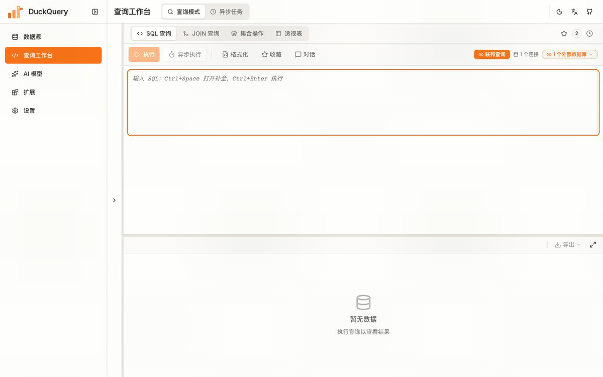

<p align="center">
  
</p>

<h1 align="center">DuckQuery</h1>

<p align="center">
  <strong>把文件、数据库和 AI，放进同一个 SQL 工作台。</strong><br>
  用 Excel 核对业务库，用一条 SQL 关联多个数据源，或让智能体先查数据再回答。
</p>

<p align="center">
  <a href="https://github.com/Chenkeliang/duckdb-query/releases/latest"></a>
  <a href="LICENSE"></a>
  <a href="https://github.com/Chenkeliang/duckdb-query/stargazers"></a>
</p>

<p align="center">
  <a href="https://github.com/Chenkeliang/duckdb-query/releases/latest"><strong>下载桌面版</strong></a>
  · <a href="#安装与运行">安装指南</a>
  · <a href="#能做什么">功能</a>
  · <a href="docs/README.md">文档</a>
  · <a href="https://chenkeliang.github.io/duckdb-query/">浏览器演示</a>
  · <a href="README_en.md">English</a>
</p>

DuckQuery 是独立开发、基于 DuckDB 的本地优先数据工作台，适合临时对账、跨源核查和数据探索。文件导入、数据库连接、SQL、可视化查询、图表和导出都在一个界面里完成，不需要为一次分析搭建数仓。

**不用 AI，也能完整使用查询与分析功能。** 启用 AI 时，由你选择模型服务并提供自己的 API Key。

## 安装与运行

### 桌面版（推荐）

最新发布版本为 **[v2.1.0](https://github.com/Chenkeliang/duckdb-query/releases/tag/v2.1.0)**。本文功能说明以该发布版为准；对应源码见 [v2.1.0 标签](https://github.com/Chenkeliang/duckdb-query/tree/v2.1.0)。

从 [GitHub Releases](https://github.com/Chenkeliang/duckdb-query/releases/latest) 选择与你的电脑匹配的安装包：

| 系统 | 标准包 | 离线包 |
|---|---|---|
| Windows 10 / 11 · x64 | `*_x64-setup.exe` | `*_x64-offline-setup.exe` |
| macOS · Apple 芯片 | `*_aarch64.dmg` | `*_aarch64-offline.dmg` |
| macOS · Intel | `*_x64.dmg` | `*_x64-offline.dmg` |

联网环境用标准包；首次使用部分外部数据库时会下载 DuckDB 扩展。无法在线下载扩展时选择离线包，内置相关扩展，Windows 离线包还包含 WebView2 安装器。暂不提供 Linux 桌面安装包，可使用 Docker。

`.sig`、`.app.tar.gz` 和 `latest.json` 用于应用内更新，无需单独下载。安装包未使用 Apple Developer ID 或 Microsoft 发布证书，首次运行可能出现系统提示；处理方式见[桌面版使用手册](docs/guide/桌面版使用手册.md)。

### Docker 镜像与数据

先安装 Docker 与 Docker Compose，然后运行：

```bash
git clone --branch v2.1.0 --depth 1 https://github.com/Chenkeliang/duckdb-query.git
cd duckdb-query
./quick-start.sh
```

- 工作台：[http://localhost:48000](http://localhost:48000)
- API 文档：[http://localhost:48001/docs](http://localhost:48001/docs)
- 数据库和上传数据保存在宿主机 `./data`；配置与密钥在 `./config`。备份或迁移时应一并保留。

脚本支持配置构建镜像源，详见[配置参考](docs/CONFIGURATION_ZH.md)。默认仅监听本机 `127.0.0.1`；需要共享访问时应使用带认证的反向代理，应用本身没有多用户鉴权。

### 浏览器演示（免安装）

[在线体验](https://chenkeliang.github.io/duckdb-query/)使用独立 DuckDB-Wasm，在浏览器内解析 CSV / TSV / Parquet / JSON，不上传文件到应用服务器。Excel、外部数据库连接、AI 和扩展管理请使用桌面版或 Docker。演示引擎与桌面 / Docker 后端独立。

## 能做什么

| 你的任务 | DuckQuery 提供的能力 |
|---|---|
| 把散落的文件变成可查询的数据 | CSV / Excel / Parquet / JSON / JSONL 导入、表格粘贴、URL 导入、服务器目录读取 |
| 核对文件与业务库 | 本地表与 MySQL / PostgreSQL / SQLite / DuckDB 跨源关联，支持符合条件的远端筛选优化 |
| 反复调整一条查询 | 多标签 SQL 编辑器、表与字段补全、错误位置提示、查询历史、SQL 收藏夹 |
| 少写 SQL 完成分析 | 可视化关联查询、集合运算与透视表，可查看生成的 SQL |
| 让长查询继续跑 | 异步任务、执行中转后台、任务搜索、取消、重试与结果查看；转后台继续同一次查询，不重新执行 |
| 看清结果并交付 | 虚拟滚动表格、列来源、JSON 查看、柱状 / 折线 / 面积 / 饼图 / 环形 / KPI 图表、图表下钻 |
| 把结果带走 | CSV / Excel / JSON / Parquet 导出，或保存为 DuckDB 本地表 |
| 让 AI 辅助查数 | 限定问数范围、查看结构与真实取值、只读查询、SQL 解释与优化、报错修复、图表建议 |
| 接入 AI 编程工具 | MCP 服务，供 Claude Code、Codex、Cursor 等客户端使用，提供三种权限模式 |

工作台支持中文 / English、深色 / 浅色主题、命令面板和可自定义快捷键。

## 从数据到结果

1. **接入数据。** 拖入 CSV、Excel、Parquet 或 JSON，粘贴表格，或连接 MySQL、PostgreSQL、SQLite、DuckDB。
2. **查询或提问。** 手写 SQL；用可视化界面构建关联、集合运算或透视表；也可以打开智能体，限定数据源与表后直接提问。
3. **检查与交付。** 查看表格、图表和列来源，核对 SQL，把结果导出或保存为本地表。执行中的只读查询可以转到后台，保持后端运行即可稍后从任务面板取回结果。

<details>
<summary>示例：用一条 SQL 关联本地文件与 MySQL</summary>

把本地订单与 MySQL 客户资料关联，找出已完成订单的客户和金额：

```sql
SELECT
  o.order_id,
  c.customer_name,
  c.segment,
  o.amount
FROM readme_demo_orders AS o
JOIN mysql_readme_demo_mysql.customers AS c
  ON o.customer_id = c.customer_id
WHERE o.status = 'completed'
ORDER BY o.amount DESC;
```

这里的表名与连接别名来自[演示数据](docs/assets/readme/README.md)，使用时替换为你自己的来源。一个查询可以同时使用本地表与已连接的外部数据库。

以下动图录制于 **v1.1.4**，仅用于说明跨源查询流程，不代表当前界面。



</details>

## 智能体怎么用

在查询工作台打开 AI 面板，选择它可以访问的数据源与表，然后描述问题。输入 `@` 可以加入表；输入区支持多行，`Enter` 发送，`Shift+Enter` 换行。

- **问数据：** 智能体查看结构、核对取值，并执行有行数限制的只读查询后给出回答，附可复用 SQL。统计由数据库执行；你仍应核对查询口径和结果。
- **解释或优化 SQL：** 快捷按钮先填入可编辑的问题草稿，由你确认发送。
- **使用返回的 SQL：** 先查看修改前后的差异，再选择应用；应用只更新编辑器，不自动执行。你在等待期间修改了 SQL 时，预览会提示冲突。

文件与本地表保存在运行 DuckQuery 的电脑或自托管服务器上，外部数据库仍位于原来的服务中。**使用 AI 时，所选范围内的结构、问题和限量查询结果可能发送给你配置的模型服务**；请按数据要求选择本地或远程模型。

## 通过 MCP 连接 AI 工具

先启动 DuckQuery 桌面版或 Docker，再运行：

```bash
uvx duckquery-mcp
```

Claude Code 可直接添加：

```bash
claude mcp add duckquery -- uvx duckquery-mcp
```

| 权限模式 | 行为 |
|---|---|
| `read-only` | 不开放修改工具，阻止变更请求 |
| `normal`（默认） | 修改工具可用，变更必须显式确认 |
| `full` | 跳过 MCP 的确认门控，后端限制仍有效 |

客户端配置、后端自动发现与具体工具见 [MCP 文档](mcp/README.md)。MCP 包版本与应用版本独立发布。

## 引擎与升级须知

最新发布的 **应用版本为 v2.1.0**，主要更新包括工作台布局、执行中转后台、SQL 补全和 AI SQL 差异预览，详见 [v2.1.0 发布说明](https://github.com/Chenkeliang/duckdb-query/blob/v2.1.0/docs/releases/v2.1.0.md)。

应用版本与 DuckDB **引擎版本**分别维护。v2.1.0 发布版固定引擎 `v2.0.0-alpha39998`，Python 包为 `1.6.0.dev379`；新数据库使用 `v2.0.0` 存储格式。DuckDB 引擎仍为预发布版本，应用更新不代表已切换到正式引擎。

从 DuckQuery 2.0.x 升级不新增存储迁移。从 1.x 升级前，请备份 `main.db`、`system.db` 及对应 `.wal`，再阅读 [2.0 大版本说明](docs/releases/v2.0.0.md)。旧库不会在启动时静默迁移；显式迁移到新存储格式后，应通过升级前备份恢复旧版本。

历史发布说明：[v2.0.1](docs/releases/v2.0.1.md) · [v2.0.0](docs/releases/v2.0.0.md)。

“设置 → DuckDB 数据库存储”可查看资源预算、检查最近备份和查看恢复指引。扩展按引擎版本隔离；详细兼容范围见[引擎升级方案](docs/specs/duckdb-2-compatibility-and-capabilities.md)。

## 文档与参与

[文档索引](docs/README.md) · [配置参考](docs/CONFIGURATION_ZH.md) · [使用手册](docs/guide/桌面版使用手册.md) · [参与贡献](CONTRIBUTING.md) · [行为准则](CODE_OF_CONDUCT.md)

遇到问题或有功能建议，欢迎提交 [Issue](https://github.com/Chenkeliang/duckdb-query/issues)，说明你的场景、应用版本和复现步骤。觉得有用，也欢迎点亮 Star。

感谢 [LINUX DO](https://linux.do/) 对开源项目的支持。DuckQuery 使用 [MIT License](LICENSE)。
