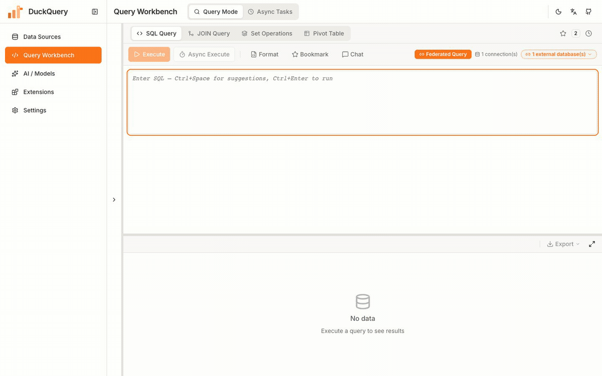

<p align="center">
  
</p>

<h1 align="center">DuckQuery</h1>

<p align="center">
  <strong>Files, databases, and AI in one SQL workbench.</strong><br>
  Reconcile Excel with your business database, join data sources in one query, or let an agent query before answering.
</p>

<p align="center">
  <a href="https://github.com/Chenkeliang/duckdb-query/releases/latest"></a>
  <a href="LICENSE"></a>
  <a href="https://github.com/Chenkeliang/duckdb-query/stargazers"></a>
</p>

<p align="center">
  <a href="https://github.com/Chenkeliang/duckdb-query/releases/latest"><strong>Download desktop</strong></a>
  · <a href="#install-and-run">Installation</a>
  · <a href="#what-you-can-do">Features</a>
  · <a href="docs/README.md">Docs</a>
  · <a href="https://chenkeliang.github.io/duckdb-query/">Browser demo</a>
  · <a href="README.md">简体中文</a>
</p>

DuckQuery is an independently developed, local-first data workbench powered by DuckDB, built for ad-hoc reconciliation, cross-source checks, and exploration. Import files, connect databases, write SQL, build visual queries, chart results, and export—all in one interface, without setting up a warehouse for a single analysis.

**AI is optional: querying and analysis work without it.** When you enable AI, you choose the model service and supply your own API key.

## Install and Run

### Desktop (Recommended)

The latest release is **[v2.1.1](https://github.com/Chenkeliang/duckdb-query/releases/tag/v2.1.1)**. Features below describe this release; its source is available at the [v2.1.1 tag](https://github.com/Chenkeliang/duckdb-query/tree/v2.1.1).

Choose the installer for your machine from [GitHub Releases](https://github.com/Chenkeliang/duckdb-query/releases/latest):

| System | Standard build | Offline build |
|---|---|---|
| Windows 10 / 11 · x64 | `*_x64-setup.exe` | `*_x64-offline-setup.exe` |
| macOS · Apple silicon | `*_aarch64.dmg` | `*_aarch64-offline.dmg` |
| macOS · Intel | `*_x64.dmg` | `*_x64-offline.dmg` |

Use the standard build when online; some external database connections download DuckDB extensions on first use. Choose the offline build when extension downloads are unavailable. It bundles the relevant extensions; the Windows offline installer also includes WebView2. Linux desktop installers are not provided; use Docker instead.

`.sig`, `.app.tar.gz`, and `latest.json` are in-app updater assets and do not need a separate download. Installers are not signed with Apple Developer ID or a Microsoft publisher certificate, so your system may show a first-run prompt. See the [desktop guide (Chinese)](docs/guide/桌面版使用手册.md) for details.

### Docker Images and Data

Install Docker and Docker Compose, then run:

```bash
git clone --branch v2.1.1 --depth 1 https://github.com/Chenkeliang/duckdb-query.git
cd duckdb-query
./quick-start.sh
```

- Workbench: [http://localhost:48000](http://localhost:48000)
- API docs: [http://localhost:48001/docs](http://localhost:48001/docs)
- Databases and uploaded data live in the host's `./data` directory; configuration and keys live in `./config`. Keep both when backing up or moving an installation.

The script supports configurable build-image mirrors; see the [configuration reference](docs/CONFIGURATION.md). By default, it binds to `127.0.0.1`. For shared access, use an authenticated reverse proxy; the application does not provide multi-user authentication.

### Browser Demo (No Installation)

[Try it online](https://chenkeliang.github.io/duckdb-query/). The demo uses a separate DuckDB-Wasm engine to parse CSV / TSV / Parquet / JSON in your browser without uploading files to the application server. Use desktop or Docker for Excel, external database connections, AI, and extension management. The demo engine is independent of the desktop / Docker backend.

## What You Can Do

| Your task | DuckQuery provides |
|---|---|
| Turn scattered files into queryable data | CSV / Excel / Parquet / JSON / JSONL import, table pasting, URL import, and server directory access |
| Reconcile files against a business database | Cross-source joins with MySQL / PostgreSQL / SQLite / DuckDB, with eligible remote filters optimized |
| Iterate on a query | SQL tabs, table and column completion, error locations, query history, and SQL bookmarks |
| Analyze without writing every query | Visual JOIN, set-operation, and pivot builders, including statistics without grouping fields, with generated SQL available to inspect |
| Keep long queries running | Async tasks, moving active queries to the background, task search, cancellation, retry, and result viewing; moving a query does not run it again |
| Understand and present results | Virtualized grid, column origins, JSON viewer, bar / line / area / pie / donut / KPI charts, and chart drill-down |
| Deliver the data | CSV / Excel / JSON / Parquet export, or save as a local DuckDB table |
| Get AI assistance | Scoped data questions, schema and value inspection, read-only queries, SQL explanation and optimization, error repair, and chart suggestions |
| Connect AI coding tools | An MCP server for Claude Code, Codex, Cursor, and other clients, with three permission modes |

The workbench supports Chinese / English, dark / light themes, a command palette, and customizable keyboard shortcuts.

## From Data to Results

1. **Connect.** Drop CSV, Excel, Parquet, or JSON files; paste a table; or connect MySQL, PostgreSQL, SQLite, or DuckDB.
2. **Query or ask.** Write SQL, use the visual JOIN / set-operation / pivot builders, or open the agent and choose the data sources and tables it can access.
3. **Review and deliver.** Inspect the grid, charts, column origins, and SQL. Export results or save them as local tables. Move an active read-only query to the background and retrieve its result from the task panel later while the backend stays running.

<details>
<summary>Example: join local files with MySQL in one SQL query</summary>

Join local orders with MySQL customer records to inspect completed orders:

```sql
SELECT
  o.order_id,
  c.customer_name,
  c.segment,
  o.amount
FROM readme_demo_orders AS o
JOIN mysql_readme_demo_mysql.customers AS c
  ON o.customer_id = c.customer_id
WHERE o.status = 'completed'
ORDER BY o.amount DESC;
```

These table names and connection aliases come from the [demo dataset](docs/assets/readme/README.md); replace them with your own sources. A query can use local tables and connected external databases together.

The animation below was recorded in **v1.1.4**. It illustrates the cross-source query flow and does not show the current interface.



</details>

## Working with the Agent

Open the AI panel in the query workbench, select the sources and tables it may access, and describe your question. Type `@` to add a table. The input supports multiple lines: `Enter` sends and `Shift+Enter` adds a newline.

- **Ask about data.** The agent inspects schemas, checks real values, and runs row-limited, read-only queries before answering with reusable SQL. The database performs the calculations; you should still review the query's assumptions and results.
- **Explain or optimize SQL.** Quick actions fill an editable question draft for you to review before sending.
- **Use returned SQL.** Review the diff before applying a change. Applying updates the editor and does not execute the SQL. If you edit the SQL while waiting, the preview flags the conflict.

Files and local tables are stored on the computer or server running DuckQuery; external databases remain on their original servers. **When AI is enabled, schemas, questions, and limited query results within the selected scope may be sent to your configured model service.** Choose a local or remote model to suit your data requirements.

## Connect AI Tools through MCP

Start DuckQuery desktop or Docker, then run:

```bash
uvx duckquery-mcp
```

For Claude Code:

```bash
claude mcp add duckquery -- uvx duckquery-mcp
```

| Permission mode | Behavior |
|---|---|
| `read-only` | Hides mutating tools and blocks mutation requests |
| `normal` (default) | Exposes mutating tools; changes require explicit confirmation |
| `full` | Bypasses MCP confirmation gates; backend restrictions still apply |

See the [MCP documentation](mcp/README.md) for client configuration, backend discovery, and tools. The MCP package is versioned separately from the app.

## Engine and Upgrade Notes

The **latest released app version is v2.1.1**. It adds pivot statistics without grouping fields and retains the v2.1.0 workbench layout, active-query backgrounding, SQL completion, and AI SQL diff previews. See the [v2.1.1 release notes](https://github.com/Chenkeliang/duckdb-query/blob/v2.1.1/docs/releases/v2.1.1_en.md).

The app and DuckDB **engine versions** are maintained separately. Release v2.1.1 pins `v2.0.0-alpha39998`, Python package `1.6.0.dev379`, and `v2.0.0` storage for new databases. The engine remains a preview; updating the app does not switch it to a stable DuckDB engine.

The current source now uses **DuckDB 2.0 stable** (`duckdb==2.0.0`, engine `v2.0.0`). This change has not been released as a desktop update; published v2.1.1 binaries are unaffected. New databases still use `v2.0.0` storage, existing files are not automatically migrated, and extensions must match the stable engine build.

Upgrading from DuckQuery 2.0.x introduces no new storage migration. Before upgrading from 1.x, back up `main.db`, `system.db`, and their `.wal` files, then read the [2.0 major-version notes](docs/releases/v2.0.0_en.md). Existing databases are not silently migrated at startup. After an explicit migration to the new storage format, restore a pre-upgrade backup to return to an older version.

Earlier release notes: [v2.1.0](docs/releases/v2.1.0_en.md) · [v2.0.1](docs/releases/v2.0.1_en.md) · [v2.0.0](docs/releases/v2.0.0_en.md).

Settings → DuckDB database storage shows resource budgets, backup checks, and recovery guidance. Extensions are isolated by engine version; see the [engine upgrade specification](docs/specs/duckdb-2-compatibility-and-capabilities.md) for compatibility details.

## Docs and Contributing

[Docs index](docs/README.md) · [Configuration](docs/CONFIGURATION.md) · [Desktop guide](docs/guide/桌面版使用手册.md) · [Contributing](CONTRIBUTING.md) · [Code of Conduct](CODE_OF_CONDUCT.md)

Found a problem or have a feature request? Open an [Issue](https://github.com/Chenkeliang/duckdb-query/issues) with your use case, app version, and reproduction steps. A Star helps others discover the project.

Thanks to [LINUX DO](https://linux.do/) for supporting open source. DuckQuery is licensed under the [MIT License](LICENSE).
